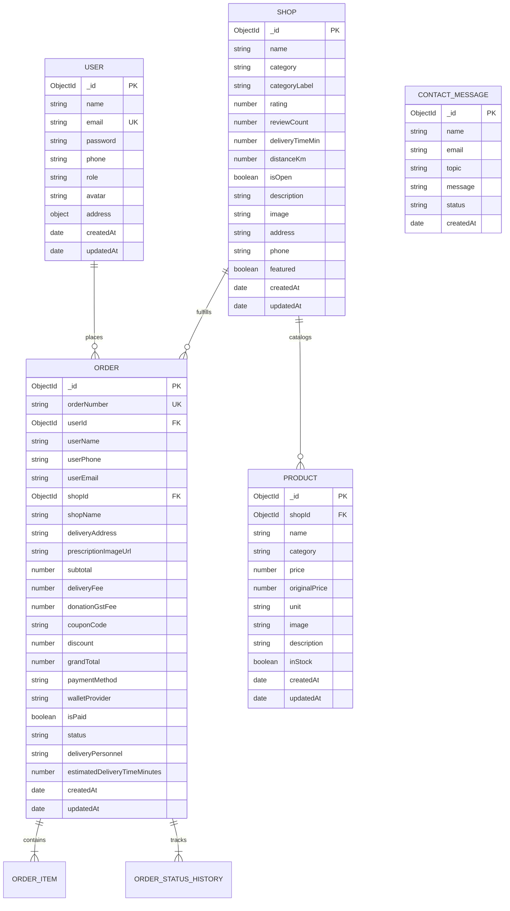

# Onbuggy Database Architecture & Schema Specification

> MongoDB schema designs, Mongoose data models, indexes, and entity relationships for the Onbuggy platform.

---

## 📊 Entity Relationship Diagram



---

## 🗄️ Detailed Collection Specifications

### 1. `users` Collection
Stores customer profiles, shopkeeper credentials, and administrators.

| Field | Type | Index | Required | Description |
| :--- | :--- | :--- | :--- | :--- |
| `_id` | `ObjectId` | Primary Key | Yes | Unique MongoDB ID |
| `name` | `String` | No | Yes | Full Name (2–50 characters) |
| `email` | `String` | Unique | Yes | Normalized lowercase email address |
| `password` | `String` | No | Yes | Bcrypt-hashed password (Salt rounds = 10) |
| `phone` | `String` | No | No | 10-digit mobile contact number |
| `role` | `String` | No | Yes | Enum: `'customer'`, `'admin'`, `'shopkeeper'`, `'delivery'` (Default: `'customer'`) |
| `avatar` | `String` | No | No | Path to profile avatar image |
| `address.street` | `String` | No | No | Street address / flat number |
| `address.area` | `String` | No | No | Locality / Sector name |
| `address.city` | `String` | No | No | City name (e.g. Rewa) |
| `address.state` | `String` | No | No | State (e.g. Madhya Pradesh) |
| `address.pincode`| `String` | No | No | Postal code (e.g. 486001) |
| `createdAt` | `Date` | No | Auto | ISO timestamp of registration |
| `updatedAt` | `Date` | No | Auto | ISO timestamp of last update |

---

### 2. `shops` Collection
Stores registered merchant partners across Medicine, Grocery, and Vegetable categories.

| Field | Type | Index | Required | Description |
| :--- | :--- | :--- | :--- | :--- |
| `_id` | `ObjectId` | Primary Key | Yes | Unique MongoDB ID |
| `name` | `String` | Text Index | Yes | Store trade name (e.g. Kamal Medical Store) |
| `category` | `String` | Single Index| Yes | Enum: `'medicine'`, `'grocery'`, `'vegetable'` |
| `categoryLabel` | `String`| No | Yes | Subtitle (e.g. "Pharmacy • OTC Care") |
| `rating` | `Number` | Single Index| Yes | Rating score 1.0 to 5.0 (Default: 4.0) |
| `reviewCount` | `Number` | No | Yes | Total customer reviews received |
| `deliveryTimeMin`| `Number`| Single Index| Yes | Estimated delivery duration in minutes |
| `distanceKm` | `Number` | Single Index| Yes | Store distance from central distribution hub |
| `isOpen` | `Boolean` | Single Index| Yes | Operational status (Open or Closed) |
| `description` | `String` | No | Yes | Detailed description of shop inventory |
| `image` | `String` | No | Yes | Shop storefront hero image path |
| `address` | `String` | No | Yes | Physical street address |
| `phone` | `String` | No | Yes | Vendor support telephone number |
| `featured` | `Boolean` | Single Index| No | Priority display on storefront |

---

### 3. `products` Collection
Maintains items offered by each shop with pricing, stock state, and category tags.

| Field | Type | Index | Required | Description |
| :--- | :--- | :--- | :--- | :--- |
| `_id` | `ObjectId` | Primary Key | Yes | Unique MongoDB ID |
| `shopId` | `ObjectId` | Ref (`Shop`)| Yes | Parent store providing this product |
| `name` | `String` | Text Index | Yes | Item title (e.g. Dolo 650mg, Aashirvaad Atta) |
| `category` | `String` | Single Index| Yes | Category alignment |
| `price` | `Number` | No | Yes | Selling price in Indian Rupees (₹) |
| `originalPrice`| `Number` | No | No | MRP / Strikethrough price for discounts |
| `unit` | `String` | No | Yes | Measurement unit (`strip`, `kg`, `bottle`, `pack`) |
| `image` | `String` | No | Yes | Asset path to product PNG |
| `inStock` | `Boolean` | No | Yes | Availability toggle |

---

### 4. `orders` Collection
Maintains transaction histories, delivery statuses, applied discounts, and live tracking timelines.

| Field | Type | Index | Required | Description |
| :--- | :--- | :--- | :--- | :--- |
| `_id` | `ObjectId` | Primary Key | Yes | Unique MongoDB ID |
| `orderNumber` | `String` | Unique Index| Yes | Human-readable order identifier (e.g. `OB-2732`) |
| `userId` | `ObjectId` | Ref (`User`)| No | Associated customer account |
| `userName` | `String` | No | Yes | Delivery recipient name |
| `userPhone` | `String` | No | Yes | Delivery contact phone |
| `shopId` | `ObjectId` | Ref (`Shop`)| No | Fulfilling store |
| `shopName` | `String` | No | Yes | Fulfilling store name |
| `deliveryAddress`| `String`| No | Yes | Full delivery destination |
| `prescriptionImageUrl` | `String` | No | No | Path to uploaded slip or prescription image |
| `subtotal` | `Number` | No | Yes | Item amount or estimated order value |
| `deliveryFee` | `Number` | No | Yes | Flat delivery fee (₹30) |
| `donationGstFee`| `Number`| No | Yes | Feeding India charity fee (4% or 7%) |
| `couponCode` | `String` | No | No | Applied coupon (`FIRSTTIME` or `BAPPA20`) |
| `discount` | `Number` | No | Yes | Deducted coupon discount amount |
| `grandTotal` | `Number` | No | Yes | Final payable bill |
| `paymentMethod`| `String` | No | Yes | `'Debit Card'`, `'Credit Card'`, `'Wallet'`, `'Pay-on-Delivery (COD)'` |
| `status` | `String` | Single Index| Yes | `'Order Placed'`, `'Processing'`, `'Out for Delivery'`, `'Delivered'`, `'Cancelled'` |
| `statusHistory` | `Array` | No | Yes | Array of `{ status, timestamp, note }` |

---

## ⚡ Indexing & Optimization Strategy

1. **Text Search Index**:
   ```javascript
   db.shops.createIndex({ name: "text", description: "text", categoryLabel: "text" });
   db.products.createIndex({ name: "text" });
   ```
2. **Compound Filter Indexes**:
   ```javascript
   db.shops.createIndex({ category: 1, isOpen: 1, rating: -1 });
   db.orders.createIndex({ userId: 1, createdAt: -1 });
   ```
3. **Unique Constraints**:
   ```javascript
   db.users.createIndex({ email: 1 }, { unique: true });
   db.orders.createIndex({ orderNumber: 1 }, { unique: true });
   ```

