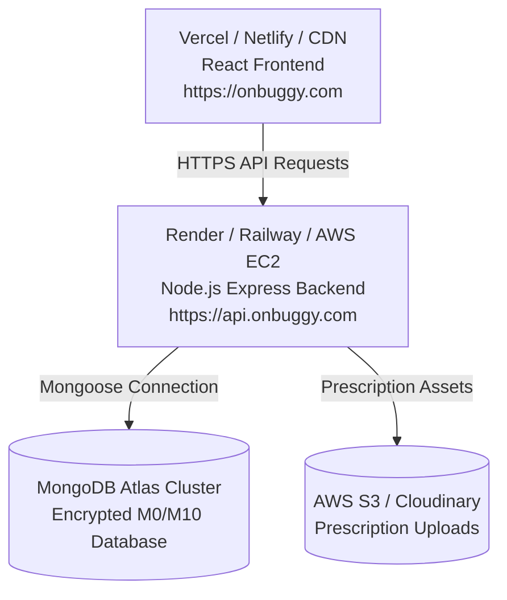

# Onbuggy Production Deployment Guide

> Step-by-step instructions for deploying Onbuggy to production cloud infrastructure, containers, and serverless platforms.

---

## ☁️ Deployment Architecture Overview



---

## Option 1: Modern Cloud Stack (Vercel + Render + MongoDB Atlas)

### Step 1: Database Setup on MongoDB Atlas
1. Create a free M0 cluster on [MongoDB Atlas](https://www.mongodb.com/cloud/atlas).
2. Create a database user with read/write privileges.
3. In **Network Access**, add `0.0.0.0/0` (allow access from anywhere) or whitelist your backend IP.
4. Copy your connection string:
   ```text
   mongodb+srv://<username>:<password>@cluster0.mongodb.net/onbuggy?retryWrites=true&w=majority
   ```

### Step 2: Deploy Backend to Render.com (Separated Server)
1. Push your repository to GitHub.
2. Log in to [Render.com](https://render.com) and click **New + ➔ Web Service** (or use the included `render.yaml` Blueprint).
3. Connect your GitHub repository and set the following settings:
   * **Name**: `onbuggy-server`
   * **Root Directory**: `server`
   * **Runtime**: `Node`
   * **Build Command**: `npm install && npm run build`
   * **Start Command**: `npm start`
   * **Health Check Path**: `/api/health`
   * **Plan**: `Free`
4. In **Environment Variables**, add:
   ```env
   NODE_ENV=production
   PORT=5000
   MONGO_URI=mongodb+srv://<username>:<password>@cluster0.mongodb.net/onbuggy?retryWrites=true&w=majority
   JWT_SECRET=your_super_secure_random_jwt_key_64_chars_min
   JWT_EXPIRE=30d
   CLIENT_URL=https://your-frontend.vercel.app
   KEEP_ALIVE_INTERVAL_MINS=10
   ```
5. Click **Create Web Service**.
6. Once deployed, copy your public service URL (e.g. `https://onbuggy-server.onrender.com`).

---

### Step 3: Prevent Render Server From Sleeping (Anti-Sleep System)

Render.com free-tier web services automatically go to sleep after 15 minutes of inactivity. We provide 4 layers of protection so your server stays awake 24/7 without delays:

#### Method A: Built-in Auto Keep-Alive (Automatic)
The server includes [`server/src/utils/keepAlive.ts`](file:///c:/WEB/React/onbuggy/server/src/utils/keepAlive.ts).
* Render automatically injects `RENDER_EXTERNAL_URL` in production.
* When running in production, the server starts an internal daemon that sends an HTTP GET request to its own `/api/health` endpoint every **10 minutes**.
* This triggers Render's inbound proxy, resetting the 15-minute inactivity countdown and keeping the container permanently live!

#### Method B: Standalone Anti-Sleep Script
You can run the included standalone script from any local terminal or secondary server:
```bash
cd server
npm run keep-alive https://onbuggy-server.onrender.com
```

#### Method C: GitHub Actions Keep-Alive (Included in `.github/workflows/keep-alive.yml`)
The repository includes an automatic scheduled GitHub Action that runs every 14 minutes:
1. In your GitHub repository, go to **Settings ➔ Secrets and variables ➔ Actions**.
2. Add a new repository secret:
   * **Name**: `RENDER_SERVER_URL`
   * **Value**: `https://onbuggy-server.onrender.com`
3. GitHub Actions will automatically ping your Render backend every 14 minutes for free!

#### Method D: Free External Monitor (UptimeRobot / Cron-Job.org)
1. Go to [UptimeRobot.com](https://uptimerobot.com) (free account).
2. Click **Add New Monitor**:
   * **Monitor Type**: `HTTP(s)`
   * **Friendly Name**: `Onbuggy Render API`
   * **URL**: `https://onbuggy-server.onrender.com/api/health`
   * **Monitoring Interval**: `Every 5 or 10 minutes`
3. Save. UptimeRobot will ping your server around the clock, guaranteeing 100% uptime.

---

### Step 4: Deploy Frontend to Vercel (Separated Client)
1. Log in to [Vercel](https://vercel.com) and click **Add New... ➔ Project**.
2. Import your GitHub repository.
3. In the project setup screen, configure:
   * **Framework Preset**: `Vite`
   * **Root Directory**: Click "Edit" and choose `client`
   * **Build Command**: `npm run build`
   * **Output Directory**: `dist`
4. In **Environment Variables**, add your Render backend URL:
   ```env
   VITE_API_URL=https://onbuggy-server.onrender.com/api
   VITE_SOCKET_URL=https://onbuggy-server.onrender.com
   ```
5. Click **Deploy**.
6. The included [`client/vercel.json`](file:///c:/WEB/React/onbuggy/client/vercel.json) automatically configures SPA client-side route rewrites and security headers so direct navigation to `/merchant`, `/my-orders`, and `/delivery` works cleanly.

---

## Option 2: Docker Containerized Deployment

To deploy Onbuggy on an Ubuntu VPS, DigitalOcean Droplet, or AWS EC2 using Docker Compose:

### `server/Dockerfile`
```dockerfile
FROM node:22-alpine AS builder
WORKDIR /app
COPY package*.json ./
RUN npm ci
COPY . .
RUN npm run build

FROM node:22-alpine AS runner
WORKDIR /app
ENV NODE_ENV=production
COPY package*.json ./
RUN npm ci --only=production
COPY --from=builder /app/dist ./dist
EXPOSE 5000
CMD ["node", "dist/index.js"]
```

### `docker-compose.yml` (Root)
```yaml
version: '3.8'

services:
  mongodb:
    image: mongo:8.0
    container_name: onbuggy-mongo
    restart: always
    ports:
      - "27017:27017"
    volumes:
      - mongo-data:/data/db

  server:
    build: ./server
    container_name: onbuggy-server
    restart: always
    ports:
      - "5000:5000"
    environment:
      - PORT=5000
      - NODE_ENV=production
      - MONGO_URI=mongodb://mongodb:27017/onbuggy
      - JWT_SECRET=super_secret_docker_key_2026
      - CLIENT_URL=http://localhost
    depends_on:
      - mongodb

volumes:
  mongo-data:
```

Run containers:
```bash
docker-compose up -d --build
```

---

## 🔒 Security Best Practices Checklist

- [x] **Helmet**: Enforce secure HTTP security headers (HSTS, X-Content-Type-Options, Frameguard).
- [x] **CORS Configuration**: Restrict allowed origins to production domains.
- [x] **Bcrypt Salt Rounds**: 10 rounds minimum for hashing sensitive passwords.
- [x] **File Upload Restrictions**: Only allow `image/jpeg`, `image/png`, `image/webp` with a strict 5MB limit.
- [ ] **Rate Limiting**: Add `express-rate-limit` for DDoS prevention on `/api/auth/login` (recommended in high-traffic deployments).

