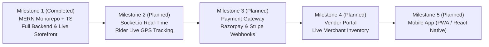

# Onbuggy Platform Roadmap & Architecture Evolution

> Strategic milestones, architecture decisions, and roadmap for scaling Onbuggy from an experimental prototype into a production-grade hyperlocal delivery enterprise.

---

## 🗺️ Milestone Overview

---

## 🏆 Milestone 1: Full-Stack MERN Architecture Upgrade (Completed)

* [x] **Monorepo Structure**: Separation of concerns into `server/` (Node/Express/Mongoose/TS) and `client/` (React/Vite/TS) with root concurrent orchestrators.
* [x] **Database Integration**: MongoDB database models for `User`, `Shop`, `Product`, `Order`, and `ContactMessage`.
* [x] **Secure Authentication**: JWT token authentication with bcrypt password hashing, input sanitization, and demo 1-click credential filling.
* [x] **Live Storefront Directory**: 12 seeded shops with real-time category filtering (`Medicine`, `Grocery`, `Vegetable`), search queries, and sorting.
* [x] **Prescription & Slip Checkout Engine**: File upload with client & server-side size/type validation, dynamic fee calculations (flat ₹30 delivery fee, 4%/7% charity fee), and coupon engines (`FIRSTTIME`, `BAPPA20`).
* [x] **Order Tracking System**: 4-Stage visual timeline (`Order Placed` $\rightarrow$ `Processing` $\rightarrow$ `Out for Delivery` $\rightarrow$ `Delivered`) with pulsing indicators and a testing stage simulator.
* [x] **Legacy Preservation**: Archived the original static HTML/CSS/JS files into `legacy-static/`.

---

## 🚀 Milestone 2: Real-time WebSockets & Live Rider GPS Tracking

* [ ] **Socket.io Integration**:
  * Establish bidirectional WebSocket channels between customers, delivery riders, and dispatchers.
  * Push automated state transitions to the `OrderTracker` without manual polling.
* [ ] **Live Rider Geolocation Coordinates**:
  * Stream rider lat/long coordinates onto an interactive Mapbox / Google Maps vector canvas.
  * Compute real-time turn-by-turn remaining delivery minutes using Distance Matrix APIs.
* [ ] **Browser Notifications**:
  * Web Push API alerts for status updates ("Rider has picked up your medicine", "Rider is 2 minutes away").

---

## 💳 Milestone 3: Production Payment Gateway Integration

* [ ] **Razorpay & Cashfree Gateway**:
  * Integrate Razorpay Standard Checkout for UPI QR codes, Google Pay, PhonePe, and Netbanking.
  * Implement HMAC-SHA256 signature verification in Express webhook controllers (`/api/payments/verify`).
* [ ] **Stripe International Processing**:
  * Support international cards with 3D-Secure authentication.
* [ ] **Automated Refunds**:
  * Automatic instant refund webhooks when an order is cancelled prior to dispatch.

---

## 🏬 Milestone 4: Merchant Partner Dashboard & Inventory Management

* [ ] **Merchant Portal (`/merchant`)**:
  * Dedicated dashboard for pharmacy and grocery owners to view new incoming orders with sound alerts.
  * One-click accept, packaging, and dispatch triggers.
* [ ] **Stock & Pricing Management**:
  * Ability for shopkeepers to adjust item prices, mark items out of stock, and set custom delivery radius.
* [ ] **Prescription OCR & Auto-Cart**:
  * Leverage Google Cloud Vision OCR to parse handwritten doctor prescriptions into cart items automatically.

---

## 📱 Milestone 5: Mobile App & PWA Expansion

* [ ] **Progressive Web App (PWA)**:
  * Service worker caching for offline storefront browsing and home screen install banners.
* [ ] **React Native / Capacitor Port**:
  * Native iOS and Android builds leveraging the existing TypeScript models and API client.

